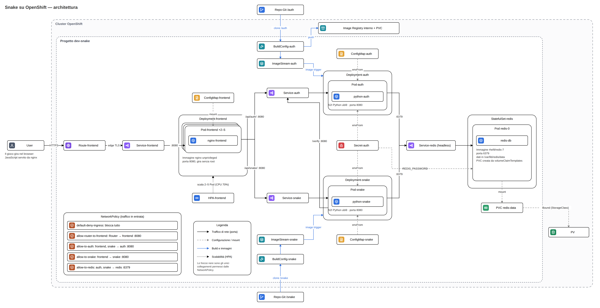
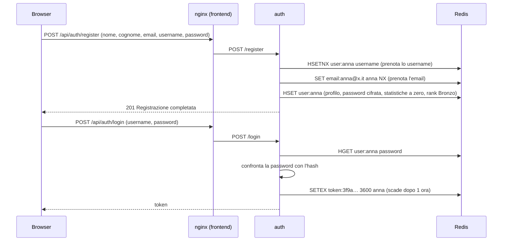
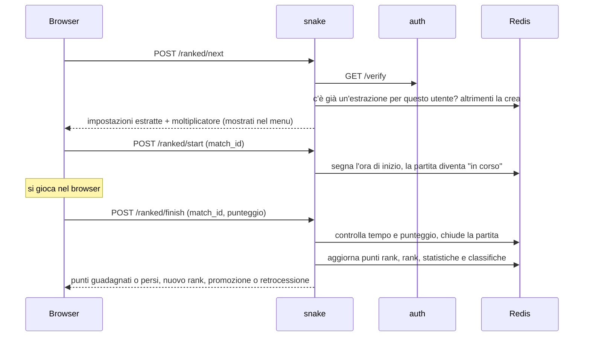

# Snake su OpenShift

Il gioco **Snake** come applicazione web a microservizi, installata su **OpenShift** usando solo la console web.

Si può giocare come ospite oppure con un account. Con l'account le partite vengono salvate, si entra in classifica e si può giocare in **classificata**: ogni partita fa salire o scendere un **rank** (Bronzo, Argento, Oro, Platino, Diamante).

L'applicazione è divisa in quattro componenti, ognuno nel suo container:

| Componente | Cosa fa | Tecnologia |
|---|---|---|
| **frontend** | serve la pagina del gioco e smista le chiamate verso i backend | nginx |
| **auth** | registrazione, login, sessioni, profilo utente | Python (Flask + gunicorn) |
| **snake** | regole del gioco, partite, classifiche, rank | Python (Flask + gunicorn) |
| **redis** | database: utenti, sessioni, statistiche, classifiche | Redis 7 |

---

## Indice

1. [Architettura](#1-architettura)
2. [Come comunicano i componenti](#2-come-comunicano-i-componenti)
3. [Cosa succede quando si usa il sito](#3-cosa-succede-quando-si-usa-il-sito)
4. [I componenti nel dettaglio](#4-i-componenti-nel-dettaglio)
5. [Il database](#5-il-database)
6. [Il gioco](#6-il-gioco)
7. [Partita classificata e rank](#7-partita-classificata-e-rank)
8. [Configurazione: ConfigMap e Secret](#8-configurazione-configmap-e-secret)
9. [Build: dal codice al container](#9-build-dal-codice-al-container)
10. [Sicurezza](#10-sicurezza)
11. [Scalabilità e resilienza](#11-scalabilità-e-resilienza)
12. [Installazione passo passo](#12-installazione-passo-passo)
13. [Verifiche e test](#13-verifiche-e-test)
14. [API](#14-api)
15. [Problemi incontrati e soluzioni](#15-problemi-incontrati-e-soluzioni)
16. [Struttura del repository](#16-struttura-del-repository)

---

## 1. Architettura



*Figura 1: architettura completa del progetto.*

### Come leggere lo schema

| Elemento | Significato |
|---|---|
| Riquadro tratteggiato esterno | il **cluster OpenShift** |
| Riquadro tratteggiato interno | il **progetto** `dev-snake`, dove vive l'applicazione |
| Fuori dal cluster | l'**utente** con il browser e il **repository Git** |
| Freccia nera | **traffico di rete**, con la porta; sono gli unici collegamenti permessi dalle NetworkPolicy |
| Freccia grigia tratteggiata | **configurazione**: una ConfigMap o un Secret letti dal Pod (`envFrom`), oppure un volume montato (`mount`) |
| Freccia blu | **build**: dal codice su Git all'immagine del container |
| Freccia puntinata | **scalabilità**: l'HPA che aggiunge o toglie Pod al frontend |

### Gli oggetti OpenShift usati

| Oggetto | A cosa serve in questo progetto |
|---|---|
| **Pod** | il container in esecuzione. Non si crea mai a mano: lo creano Deployment e StatefulSet |
| **Deployment** | tiene in vita i Pod di frontend, auth e snake; se un Pod muore ne crea un altro |
| **StatefulSet** | come una Deployment, ma per Redis: dà al Pod un nome fisso (`redis-0`) e un disco tutto suo |
| **Service** | un indirizzo stabile (nome DNS) che inoltra il traffico ai Pod giusti, scelti tramite le loro etichette |
| **Route** | espone il frontend su internet con un indirizzo HTTPS |
| **ConfigMap** | configurazione non segreta (indirizzi, porte, parametri) e file (la pagina del gioco) |
| **Secret** | dati sensibili: la password di Redis |
| **PersistentVolumeClaim (PVC)** | la richiesta di spazio disco per i dati di Redis |
| **PersistentVolume (PV)** | il disco vero, creato in automatico dalla StorageClass del cluster |
| **BuildConfig** | la "ricetta" per costruire l'immagine di auth e snake partendo dal codice su Git |
| **ImageStream** | il riferimento all'immagine costruita; avvisa la Deployment quando ne arriva una nuova |
| **HorizontalPodAutoscaler (HPA)** | aggiunge Pod al frontend quando c'è carico, li toglie quando cala |
| **NetworkPolicy** | firewall interno: decide quali Pod possono parlare con quali |

---

## 2. Come comunicano i componenti

### Gli indirizzi interni

Dentro il cluster, ogni Service ha un **nome DNS** uguale al suo nome. Un Pod che vuole parlare con auth chiama semplicemente `http://auth:8080`, e il DNS del cluster lo trasforma nell'indirizzo giusto. Il nome completo sarebbe `auth.dev-snake.svc.cluster.local`, ma dentro lo stesso progetto basta il nome corto.

Per questo **i nomi dei Service sono importanti**: sono scritti nella configurazione degli altri componenti, e una lettera sbagliata basta a rompere il collegamento (vedi la [sezione 15](#15-problemi-incontrati-e-soluzioni)).

| Service | Porta | Tipo | Chi lo chiama | Dove è scritto il nome |
|---|---|---|---|---|
| `frontend` | 8080 | ClusterIP | il router di OpenShift (Route) | nella Route |
| `auth` | 8080 | ClusterIP | frontend, snake | `default.conf` di nginx; `AUTH_URL` nella ConfigMap `snake` |
| `snake` | 8080 | ClusterIP | frontend | `default.conf` di nginx |
| `redis` | 6379 | headless | auth, snake | `REDIS_HOST` nelle ConfigMap `auth` e `snake` |

Il Service `redis` è **headless** (`clusterIP: None`): non ha un indirizzo virtuale proprio, e il suo nome DNS risponde direttamente con l'indirizzo del Pod `redis-0`. È il tipo di Service che si usa con gli StatefulSet.

### Tutti i collegamenti

| Da | A | Indirizzo | Perché |
|---|---|---|---|
| Browser | Route | `https://<indirizzo della Route>` | aprire il sito e chiamare le API |
| Route (router) | frontend | Service `frontend:8080` | la Route inoltra tutto al frontend |
| frontend | auth | `http://auth:8080` | tutto ciò che il browser chiede a `/api/auth/...` |
| frontend | snake | `http://snake:8080` | tutto ciò che il browser chiede a `/api/snake/...` |
| snake | auth | `http://auth:8080/verify` | sapere a quale utente appartiene un token |
| auth | redis | `redis:6379` | utenti, password, sessioni, profilo |
| snake | redis | `redis:6379` | partite, statistiche, classifiche, rank |

Il browser **non parla mai direttamente** con auth, snake o Redis: passa sempre dal frontend. In questo modo i backend non sono esposti su internet e non servono configurazioni CORS.

### Il reverse proxy di nginx

nginx serve la pagina e fa da **reverse proxy**: guarda il percorso della richiesta e la inoltra al backend giusto, togliendo il prefisso.

```nginx
location /api/auth/  { proxy_pass http://auth:8080/;  }   # /api/auth/login   → auth:/login
location /api/snake/ { proxy_pass http://snake:8080/; }   # /api/snake/score  → snake:/score
location /           { try_files $uri $uri/ /index.html; } # tutto il resto: la pagina del gioco
```

### Le NetworkPolicy

Di default, in un progetto OpenShift **ogni Pod può parlare con ogni altro**. Le NetworkPolicy (`openshift/09-network-policies.yaml`) applicano il principio del **minimo privilegio**: si blocca tutto, poi si permettono solo i collegamenti della tabella qui sopra.

| Policy | Cosa permette |
|---|---|
| `default-deny-ingress` | niente: blocca tutto il traffico in entrata verso tutti i Pod del progetto |
| `allow-router-to-frontend` | il router di OpenShift → frontend, porta 8080 |
| `allow-to-auth` | frontend e snake → auth, porta 8080 |
| `allow-to-snake` | frontend → snake, porta 8080 |
| `allow-to-redis` | auth e snake → redis, porta 6379 |

Le policy riconoscono i Pod dall'**etichetta** `app` (`app=frontend`, `app=auth`, …). Il router viene riconosciuto dall'etichetta del suo progetto, `openshift-ingress`. Il risultato è che **Redis è raggiungibile solo dai due backend**, e da fuori si entra solo dalla Route.

---

## 3. Cosa succede quando si usa il sito

### Apertura della pagina

1. Il browser apre l'indirizzo HTTPS della Route.
2. Il **router** di OpenShift termina la connessione HTTPS (TLS *edge*) e inoltra la richiesta in HTTP al Service `frontend`.
3. Il Service sceglie uno dei Pod nginx (sono da 2 a 5, grazie all'HPA).
4. nginx risponde con `index.html`, che legge dalla ConfigMap `frontend` montata come file.
5. Il browser carica il JavaScript del gioco e chiede a snake le impostazioni iniziali (`/api/snake/config`) e la classifica (`/api/snake/leaderboard`).

### Registrazione e login



Il browser conserva il token in `sessionStorage` e lo manda a ogni richiesta successiva nell'intestazione `Authorization: Bearer <token>`. Il token **scade da solo** dopo `TOKEN_TTL` secondi (1 ora), perché Redis cancella la chiave in automatico. Al logout, auth la cancella subito.

### Partita normale

1. La partita si svolge **tutta nel browser**: il serpente si muove, mangia e cresce grazie al JavaScript della pagina. Nessuna richiesta di rete durante il gioco.
2. A fine partita il browser manda il punteggio: `POST /api/snake/score` con il token.
3. snake chiede ad auth chi è l'utente: `GET http://auth:8080/verify`.
4. snake controlla che il punteggio sia possibile, poi aggiorna Redis in un'unica transazione: +1 partita giocata, ultimo punteggio, record e classifica.

### Partita classificata



Tutte le chiamate del browser verso snake passano da nginx (`/api/snake/...`); nel diagramma il passaggio è omesso per chiarezza. Le regole complete sono nella [sezione 7](#7-partita-classificata-e-rank).

### Classifica

`GET /api/snake/leaderboard?type=ranked` restituisce i primi 10 per punti rank; con `type=record`, i primi 10 per miglior punteggio. Per ogni giocatore snake legge anche il rank dal profilo, così l'icona del rank compare accanto al nome, visibile a tutti.

---

## 4. I componenti nel dettaglio

### frontend (nginx)

| | |
|---|---|
| Immagine | `nginxinc/nginx-unprivileged` (nginx che gira senza root, sulla porta 8080) |
| Oggetti | Deployment `frontend`, Service `frontend`, Route `frontend`, ConfigMap `frontend`, HPA `frontend` |
| Configurazione | la ConfigMap `frontend` contiene due file, montati nel container con `subPath`: `default.conf` (configurazione di nginx) e `index.html` (tutta la pagina del gioco) |
| Risorse | richiesta 50m CPU e 32Mi di memoria, limite 200m e 128Mi |

L'immagine nginx standard non funziona su OpenShift: vuole girare come root e ascoltare sulla porta 80, entrambe cose che OpenShift vieta per sicurezza. Per questo si usa la versione *unprivileged*.

### auth (Python)

Gestisce gli account e le sessioni. È l'unico componente che legge e scrive le password.

| Endpoint | Cosa fa |
|---|---|
| `POST /register` | crea l'account: controlla i dati, impedisce username ed email doppi, salva la password cifrata e inizializza statistiche e rank |
| `POST /login` | controlla la password e crea un token di sessione |
| `GET /verify` | dato un token, restituisce lo username (usato da snake) |
| `GET /me` | profilo completo, statistiche e rank, **senza password** |
| `POST /logout` | cancella il token |
| `GET /health` | stato del servizio e della connessione a Redis |

### snake (Python)

Gestisce tutto ciò che riguarda le partite. Non si fida mai del browser: verifica l'utente tramite auth e controlla che i punteggi siano possibili.

| Endpoint | Cosa fa |
|---|---|
| `GET /config` | impostazioni iniziali e regole dei rank |
| `POST /score` | salva una partita normale |
| `POST /ranked/next` | estrae (o ripropone) le impostazioni della prossima classificata |
| `POST /ranked/start` | avvia la classificata estratta |
| `POST /ranked/finish` | chiude la classificata e aggiorna il rank |
| `GET /leaderboard?type=ranked\|record` | classifiche |
| `GET /health` | stato del servizio e della connessione a Redis |

Entrambi i servizi Python girano con **gunicorn** sulla porta 8080, come previsto dall'immagine Python di OpenShift. Leggono tutta la configurazione dalle variabili d'ambiente, che arrivano da ConfigMap e Secret.

### redis (database)

| | |
|---|---|
| Immagine | `rhel9/redis-7` di Red Hat (gira senza root, legge la password dalla variabile `REDIS_PASSWORD`) |
| Oggetti | StatefulSet `redis` (1 replica), Service `redis` headless, PVC `redis-data-redis-0`, PV |
| Dati | nella cartella `/var/lib/redis/data`, che è il disco persistente |
| Password | dal Secret `auth`, chiave `REDIS_PASSWORD` |

La struttura dei dati è spiegata nella prossima sezione.

---

## 5. Il database

### Perché Redis

Redis è un database **chiave-valore** che tiene i dati in memoria, quindi è molto veloce, e li salva anche su disco. Si adatta bene a questo progetto perché offre già le strutture che servono:

| Tipo Redis | Cos'è | Dove lo usiamo |
|---|---|---|
| **hash** | un oggetto con più campi, come una riga di tabella | il profilo di ogni utente |
| **stringa** con scadenza | un valore che si cancella da solo dopo N secondi | i token di sessione |
| **sorted set** | un insieme di elementi già ordinati per punteggio | le classifiche |

### Come sono salvati i dati su disco

Lo StatefulSet usa un `volumeClaimTemplates`: quando crea il Pod `redis-0`, crea anche la PVC `redis-data-redis-0` (1Gi, `ReadWriteOnce`). La StorageClass del cluster crea automaticamente il **PV**, cioè il disco vero, e lo collega alla PVC.

```
StatefulSet redis ──crea──► Pod redis-0 ──monta──► PVC redis-data-redis-0 ──Bound──► PV (disco)
                                            in /var/lib/redis/data
```

Se il Pod viene cancellato o si riavvia, lo StatefulSet lo ricrea **con lo stesso nome** e lo ricollega **allo stesso disco**: i dati non si perdono.

### Le chiavi

| Chiave | Tipo | Contenuto | Scritta da | Scadenza |
|---|---|---|---|---|
| `user:<username>` | hash | profilo, statistiche e rank dell'utente | auth, snake | mai |
| `email:<email>` | stringa | lo username che usa quell'email | auth | mai |
| `token:<token>` | stringa | lo username della sessione | auth | `TOKEN_TTL` (1 ora) |
| `leaderboard` | sorted set | username → miglior punteggio | snake | mai |
| `ranked_leaderboard` | sorted set | username → punti rank | snake | mai |
| `match:<id>` | hash | una partita classificata: impostazioni, moltiplicatore, ora di inizio | snake | 7 giorni se non iniziata, 2 ore se iniziata |
| `ranked:next:<username>` | stringa | id della prossima classificata già estratta | snake | 7 giorni |
| `ranked:active:<username>` | stringa | id della classificata in corso | snake | 2 ore |

### Il profilo utente: `user:<username>`

Ogni utente ha **una sola scheda** con tutti i suoi dati. auth scrive l'anagrafica e la password, snake scrive le statistiche di gioco e il rank.

| Campo | Esempio | Scritto da | Significato |
|---|---|---|---|
| `username` | `anna` | auth | nome utente |
| `nome` | `Anna` | auth | nome |
| `cognome` | `Rossi` | auth | cognome |
| `email` | `anna@example.it` | auth | email, salvata in minuscolo |
| `password` | `scrypt:32768:8:1$…` | auth | **hash** della password, mai la password in chiaro |
| `created_at` | `2026-10-13T09:06:36+00:00` | auth | data di registrazione |
| `games_played` | `31` | snake | partite giocate in totale (normali e classificate) |
| `best_score` | `40` | snake | miglior punteggio |
| `last_score` | `12` | snake | punteggio dell'ultima partita |
| `rank` | `oro` | auth (Bronzo alla registrazione), poi snake | rank attuale |
| `rank_points` | `312` | snake | punti rank |
| `ranked_games` | `14` | snake | partite classificate giocate |

Esempio, visto con `redis-cli`:

```
> HGETALL user:anna
 1) "username"       2) "anna"
 3) "nome"           4) "Anna"
 5) "cognome"        6) "Rossi"
 7) "email"          8) "anna@example.it"
 9) "password"      10) "scrypt:32768:8:1$xTJnQ9Lf...$e26325e7..."
11) "created_at"    12) "2026-10-13T09:06:36+00:00"
13) "games_played"  14) "31"
15) "best_score"    16) "40"
17) "last_score"    18) "12"
19) "rank"          20) "oro"
21) "rank_points"   22) "312"
23) "ranked_games"  24) "14"
```

### Le classifiche: i sorted set

Un sorted set tiene ogni username associato a un numero e li mantiene **già ordinati**. Leggere la top 10 è un solo comando (`ZREVRANGE leaderboard 0 9 WITHSCORES`), anche con migliaia di giocatori.

- `leaderboard` si aggiorna con `ZADD ... GT`, che scrive il nuovo punteggio **solo se è più alto** di quello salvato: così contiene sempre il record di ogni giocatore.
- `ranked_leaderboard` si aggiorna a ogni classificata con i punti rank attuali, che possono anche scendere.

### Come evitiamo dati incoerenti

Più Pod possono scrivere nello stesso momento, quindi le operazioni delicate sono atomiche, cioè o avvengono per intero o non avvengono:

| Situazione | Soluzione |
|---|---|
| Due persone si registrano con lo stesso username nello stesso istante | `HSETNX` scrive il campo `username` solo se non esiste: vince solo la prima |
| Email già usata da un altro account | `SET email:<email> ... NX` scrive solo se la chiave non esiste; se fallisce, la registrazione viene annullata |
| Fine partita: più campi da aggiornare insieme | `MULTI/EXEC` (pipeline transazionale): partite, ultimo punteggio e classifica cambiano tutti insieme |
| Una classificata chiusa due volte | la partita si chiude cancellando `match:<id>`; `DEL` restituisce 1 solo alla prima chiamata, le successive vengono rifiutate |

### Vedere i dati

Dal Pod `redis-0` → tab **Terminal**:

```
redis-cli -a "$REDIS_PASSWORD" --no-auth-warning
KEYS user:*                                  # tutti gli utenti
HGETALL user:anna                            # il profilo di anna
HMGET user:anna rank rank_points             # solo il rank
ZREVRANGE leaderboard 0 9 WITHSCORES         # top 10 per record
ZREVRANGE ranked_leaderboard 0 9 WITHSCORES  # top 10 per punti rank
KEYS token:*                                 # sessioni attive
TTL token:<token>                            # secondi alla scadenza della sessione
```

---

## 6. Il gioco

Il gioco è scritto in JavaScript dentro `frontend/index.html` e gira **interamente nel browser**. È una scelta voluta: Snake è in tempo reale, il serpente fa un passo ogni 80–170 millisecondi. Se ogni passo dovesse andare e tornare dal server, il gioco andrebbe a scatti. Il server custodisce invece ciò che non deve essere manipolabile: utenti, punteggi, regole della classificata.

### Comandi

- **Frecce** o **W A S D** per muoversi; **Spazio** per giocare e per la pausa (anche **P** o **Esc**).
- **Telefono**: si scorre il dito sul campo.
- Il gioco va in pausa da solo se si cambia scheda del browser.

### Il menu

Prima di ogni partita, sopra punteggio e campo compare il **menu**: si sceglie **Normale** o **Classificata** e si preme **Gioca**. A fine partita il menu ricompare con il risultato.

### Impostazioni della partita normale

| Impostazione | Valori |
|---|---|
| Serpente | 6 colori |
| Cibo | classico, mela, ciliegie, banana, uva, fragola (disegni pixel art 8×8) |
| Cibo in campo | 1, 3 o 5 |
| Mappa | piccola 12×12, media 18×18, grande 24×24 |
| Velocità | lenta (170 ms per passo), normale (120 ms), veloce (80 ms) |
| Modalità | **Classica**; **Muri** (ogni cibo mangiato fa comparire un blocco); **Senza bordi** (si esce da un lato e si rientra dall'altro); **Caos** (muri e senza bordi insieme) |

"Mescola tutto" sceglie impostazioni a caso; "Casuale a ogni partita" lo fa automaticamente. Le scelte restano salvate nel browser (`localStorage`). Al primo accesso, mappa e velocità vengono da `GRID_SIZE` e `SPEED_MS` della ConfigMap `snake`.

---

## 7. Partita classificata e rank

Serve un account.

### Impostazioni

- La modalità è **sempre Caos**.
- Mappa, velocità, cibo in campo, colore e tipo di cibo li **estrae a caso il server**. Se le estraesse il browser, basterebbe modificare la pagina per scegliersi sempre quelle facili.
- L'estrazione viene mostrata nel menu **prima** di giocare, insieme al moltiplicatore e all'obiettivo.
- L'estrazione resta **la stessa finché non la si gioca**: uscire e rientrare nel menu, o ricaricare la pagina, non la cambia. Così non si può "ritirare" fino a trovare impostazioni comode.

### Il moltiplicatore di difficoltà

Ogni combinazione rende la partita più facile o più difficile. Il moltiplicatore è il prodotto dei valori:

| Impostazione | Moltiplicatori |
|---|---|
| Cibo in campo | 1 → ×1 · 3 → ×0,85 · 5 → ×0,75 (più cibo = più facile) |
| Mappa | piccola ×1,2 · media ×1 · grande ×0,9 |
| Velocità | lenta ×0,8 · normale ×1 · veloce ×1,3 |
| Modalità | Caos ×1,05 |

Va da **×0,57** (5 cibi, mappa grande, lenta) a **×1,64** (1 cibo, mappa piccola, veloce).

### Come si calcolano i punti rank

```
prestazione  = punteggio × moltiplicatore
variazione   = (prestazione − obiettivo del proprio rank) × 2,5
               arrotondata, limitata tra −30 e +40
punti rank   = punti rank + variazione   (mai sotto zero)
```

| Rank | Punti rank necessari | Obiettivo (prestazione attesa) |
|---|---|---|
| Bronzo | 0 | 6 |
| Argento | 100 | 10 |
| Oro | 250 | 15 |
| Platino | 450 | 20 |
| Diamante | 700 | 26 |

Più si sale, più l'obiettivo è alto: una partita che a Bronzo fa guadagnare punti, a Diamante ne fa perdere. Se i punti scendono sotto la soglia del proprio rank, si **retrocede**.

**Esempio.** Anna è Argento (obiettivo 10) con 240 punti. Le viene estratta una partita con 1 cibo, mappa media e velocità veloce: moltiplicatore 1 × 1 × 1,3 × 1,05 = **×1,37** (arrotondato). Mangia 12 cibi: prestazione 12 × 1,37 = 16,4; variazione (16,4 − 10) × 2,5 = +16. Arriva a 256 punti ed è **promossa a Oro**.

Sotto il campo, durante la classificata, c'è sempre l'**obiettivo in cibi**: obiettivo del rank diviso il moltiplicatore, arrotondato per eccesso. Nell'esempio di Anna: 10 ÷ 1,37 = 7,3, quindi 8 cibi. Raggiunto quello, la partita non fa perdere punti.

### Protezioni contro i trucchi

| Trucco | Protezione |
|---|---|
| Scegliersi impostazioni facili | le estrae il server |
| Rientrare nel menu finché escono impostazioni comode | l'estrazione resta la stessa finché non la si gioca |
| Chiudere la pagina quando la partita va male | una classificata iniziata e non finita conta come **0 punti** alla classificata successiva |
| Inviare un punteggio inventato | il server controlla che sia possibile nel tempo trascorso: ogni cibo richiede almeno un passo, e i passi dipendono dalla velocità |
| Chiudere due volte la stessa partita | la seconda chiusura viene rifiutata |
| Avviare una partita mai estratta | `/ranked/start` accetta solo l'estrazione salvata per quell'utente |

---

## 8. Configurazione: ConfigMap e Secret

ConfigMap e Secret arrivano nei container come **variabili d'ambiente** (`envFrom`): ogni chiave diventa una variabile con lo stesso nome. La ConfigMap `frontend` è diversa: viene montata come **file**.

### ConfigMap `auth`

| Chiave | Valore | Uso |
|---|---|---|
| `REDIS_HOST` | `redis` | nome del Service di Redis |
| `REDIS_PORT` | `6379` | porta di Redis |
| `TOKEN_TTL` | `3600` | durata della sessione in secondi |

### ConfigMap `snake`

| Chiave | Valore | Uso |
|---|---|---|
| `AUTH_URL` | `http://auth:8080` | indirizzo di auth, per `/verify` |
| `REDIS_HOST` | `redis` | nome del Service di Redis |
| `REDIS_PORT` | `6379` | porta di Redis |
| `GRID_SIZE` | `18` | mappa proposta al primo accesso |
| `SPEED_MS` | `120` | velocità proposta al primo accesso |
| `MAX_GRID_SIZE` | `24` | mappa più grande ammessa, per validare i punteggi |

### ConfigMap `frontend`

| Chiave | Montata come | Contenuto |
|---|---|---|
| `default.conf` | `/etc/nginx/conf.d/default.conf` | configurazione di nginx, con il reverse proxy |
| `index.html` | `/usr/share/nginx/html/index.html` | la pagina con tutto il gioco |

### Secret `auth`

| Chiave | Usata da | Come |
|---|---|---|
| `REDIS_PASSWORD` | redis | `secretKeyRef`: Redis la imposta come propria password all'avvio |
| `REDIS_PASSWORD` | auth, snake | `envFrom`: la usano per collegarsi a Redis |

Il Secret si crea **dalla console** e **non va messo su Git**: in YAML il valore è solo codificato in base64, non cifrato.

**Attenzione:** i Pod leggono ConfigMap e Secret **solo all'avvio**. Dopo una modifica serve **Deployment → Actions → Restart rollout**. Per Redis si cancella il Pod `redis-0`, e lo StatefulSet lo ricrea.

---

## 9. Build: dal codice al container

auth e snake vengono costruiti **dentro OpenShift** partendo dal codice su Git, con **S2I** (*Source-to-Image*):

```
Repo-Git ──► BuildConfig ──► Build (S2I Python ubi9) ──► Registry interno ──► ImageStream ──► Deployment
             (la ricetta)    (scarica il codice,          (salva                (avvisa la       (nuovi Pod con
                              installa requirements.txt,   l'immagine)           Deployment)      l'immagine nuova)
                              crea l'immagine)
```

- La BuildConfig usa la **Context dir** (`/auth` oppure `/snake`) per costruire solo la cartella giusta del repository.
- L'immagine Python di OpenShift avvia l'app con gunicorn sulla porta 8080; `application = app` in `app.py` è il nome che gunicorn cerca.
- La Deployment ha un *image trigger*: quando l'ImageStream riceve un'immagine nuova, la Deployment fa ripartire i Pod da sola.
- Dopo una modifica al codice Python: **Builds → BuildConfigs → auth/snake → Actions → Start build**.

Il frontend e Redis, invece, usano immagini già pronte: nginx-unprivileged e rhel9/redis-7.

### Il registry interno

Le build salvano le immagini nel **registry interno** del cluster (progetto `openshift-image-registry`). Nelle installazioni fatte a mano è spento, e va acceso dall'amministratore. In questo cluster usa un disco persistente (PVC `image-registry-storage`, 20Gi, `ReadWriteOnce`), con una sola replica e strategia `Recreate`.

---

## 10. Sicurezza

| Aspetto | Come è gestito |
|---|---|
| Password degli utenti | salvate solo come **hash scrypt** (Werkzeug), mai in chiaro; `/me` non le restituisce mai |
| Sessioni | token casuali di 64 caratteri, salvati in Redis con **scadenza automatica** |
| Password del database | in un **Secret**, non nel codice né su Git |
| Traffico da internet | solo **HTTPS**, con terminazione TLS sul router (*edge*); le richieste HTTP vengono reindirizzate |
| Backend e database | non esposti: niente Route, raggiungibili solo dall'interno |
| Rete interna | **NetworkPolicy** con blocco di default; solo i collegamenti necessari sono permessi |
| Container | tutti girano **senza root**, come richiede OpenShift |
| Dati dal browser | mai considerati affidabili: l'utente lo verifica auth, i punteggi li controlla snake, le regole della classificata le decide il server |

---

## 11. Scalabilità e resilienza

| Componente | Repliche | Note |
|---|---|---|
| frontend | 2–5, con **HPA** | stateless; l'HPA aggiunge Pod sopra il 70% della CPU richiesta, li toglie dopo 5 minuti di carico basso |
| auth | 1 (scalabile) | stateless: tutti i dati sono in Redis, quindi si possono aggiungere repliche o un HPA |
| snake | 1 (scalabile) | stateless, come auth |
| redis | 1 | dati su disco persistente; è l'unico **punto unico di guasto** |

Se Redis si ferma, login, salvataggi e classifiche non funzionano finché il Pod non riparte. Lo StatefulSet lo ricrea in automatico, con gli stessi dati. Per un ambiente di produzione si userebbe Redis in replica, per esempio con Sentinel; per questo progetto una replica è sufficiente.

Il frontend ha sempre almeno **2 Pod**: se uno cade o viene aggiornato, l'altro continua a servire il sito.

---

## 12. Installazione passo passo

Tutto dalla console web, nel progetto `dev-snake`. I file YAML si incollano con **"+" → Import YAML**.

| # | Cosa | Come |
|---|---|---|
| 0 | Registry interno attivo | *solo admin, una volta*: **Administration → CustomResourceDefinitions → Config (imageregistry.operator.openshift.io) → cluster** con `managementState: Managed` e storage `pvc` |
| 1 | Secret `auth` | **Workloads → Secrets → Create → Key/value secret**, chiave `REDIS_PASSWORD` |
| 2 | Redis | `openshift/01-service-redis.yaml`, poi `openshift/02-statefulset-redis.yaml` |
| 3 | ConfigMap `auth` | `openshift/03-configmap-auth.yaml` |
| 4 | auth | **Import from Git**: Context dir `/auth`, Builder Image Python **`-ubi9`**, **Name `auth`**, Deployment, porta 8080, senza Route |
| 5 | Collegare la configurazione | **Deployments → auth → Environment → envFrom**: ConfigMap `auth` + Secret `auth` |
| 6 | ConfigMap `snake` | `openshift/04-configmap-snake.yaml` |
| 7 | snake | **Import from Git**: Context dir `/snake`, Python `-ubi9`, **Name `snake`**, senza Route |
| 8 | Collegare la configurazione | **Deployments → snake → Environment → envFrom**: ConfigMap `snake` + Secret `auth` |
| 9 | frontend | `openshift/05-configmap-frontend.yaml`, `06-deployment-frontend.yaml`, `07-service-frontend.yaml` |
| 10 | Route | **Networking → Routes → Create**: Service `frontend`, porta 8080, *Secure route*, TLS *Edge*, *Redirect* |
| 11 | HPA | `openshift/08-hpa-frontend.yaml` |
| 12 | NetworkPolicy | `openshift/09-network-policies.yaml`, tutto il file in un solo import |

L'ordine conta: nginx controlla all'avvio che `auth` e `snake` esistano, quindi il frontend va creato dopo i backend.

### Aggiornamenti

| Cosa è cambiato | Cosa fare |
|---|---|
| Codice di auth o snake | push su Git, poi **Start build** sulla BuildConfig |
| La pagina del gioco o nginx | aggiornare la ConfigMap `frontend` (tab YAML), poi **Restart rollout** di `frontend` |
| Una ConfigMap dei backend | modificarla, poi **Restart rollout** della Deployment |

---

## 13. Verifiche e test

### I servizi sono vivi e raggiungono Redis

Dal Terminal di un Pod **auth** o **snake**:

```
curl -s localhost:8080/health
# {"redis":"ok","status":"ok"}
```

### Il flusso di auth, senza browser

Dal Terminal di un Pod **auth**:

```
curl -s -X POST localhost:8080/register -H 'Content-Type: application/json' \
  -d '{"nome":"Mario","cognome":"Rossi","email":"mario@example.it","username":"mario","password":"segreta1"}'
TOKEN=$(curl -s -X POST localhost:8080/login -H 'Content-Type: application/json' \
  -d '{"username":"mario","password":"segreta1"}' | python3 -c 'import sys,json; print(json.load(sys.stdin)["token"])')
curl -s localhost:8080/me -H "Authorization: Bearer $TOKEN"
```

### Persistenza

Cancellate il Pod `redis-0` (**Actions → Delete Pod**). Lo StatefulSet lo ricrea, ricollega la stessa PVC, e gli utenti esistono ancora.

### NetworkPolicy

```
# dal Pod frontend: collegamento VIETATO
nc -z -w 3 redis 6379 && echo APERTO || echo BLOCCATO        # → BLOCCATO

# dal Pod auth: collegamento PERMESSO
python3 -c "import socket; socket.create_connection(('redis', 6379), 3); print('APERTO')"   # → APERTO
```

### HPA

Generate traffico verso l'indirizzo della Route dall'esterno, e guardate **Workloads → HorizontalPodAutoscalers → frontend**: oltre il 70% di CPU i Pod salgono fino a 5, e dopo 5 minuti di calma tornano a 2.

---

## 14. API

Indirizzi visti dal browser: passano tutti da nginx.

| Metodo | Percorso | Token | Cosa fa |
|---|---|---|---|
| POST | `/api/auth/register` | no | crea un utente `{nome, cognome, email, username, password}` |
| POST | `/api/auth/login` | no | `{username, password}` → `{token, username, expires_in}` |
| GET | `/api/auth/me` | sì | profilo, statistiche e rank (senza password) |
| POST | `/api/auth/logout` | sì | invalida il token |
| GET | `/api/auth/health` | no | stato di auth e di Redis |
| GET | `/api/snake/config` | no | mappa e velocità iniziali, mappa massima, regole dei rank |
| POST | `/api/snake/score` | sì | salva una partita normale `{score}` |
| POST | `/api/snake/ranked/next` | sì | impostazioni estratte per la prossima classificata, moltiplicatore, `match_id` |
| POST | `/api/snake/ranked/start` | sì | avvia la classificata `{match_id}` |
| POST | `/api/snake/ranked/finish` | sì | chiude la classificata `{match_id, score}`: variazione, punti, rank, promozione o retrocessione |
| GET | `/api/snake/leaderboard?type=ranked` | no | top 10 per punti rank, con il rank di ciascuno |
| GET | `/api/snake/leaderboard?type=record` | no | top 10 per miglior punteggio, con il rank di ciascuno |
| GET | `/api/snake/health` | no | stato di snake e di Redis |

Il token va sempre nell'intestazione `Authorization: Bearer <token>`.

C'è anche un endpoint usato solo all'interno del cluster: `GET http://auth:8080/verify`, con cui snake scopre a chi appartiene un token. Tecnicamente è raggiungibile anche da `/api/auth/verify`, ma il gioco non lo usa.

---

## 15. Problemi incontrati e soluzioni

| Problema | Causa | Soluzione |
|---|---|---|
| Pod di auth in `ImagePullBackOff`, cerca `docker.io/library/...` | la build non aveva prodotto nessuna immagine, quindi la Deployment usava il nome provvisorio, che senza registry punta a docker.io | sistemare la build (vedi le righe sotto) |
| "an image stream cannot be used as build output" | il **registry interno** era spento, come succede nelle installazioni fatte a mano | accenderlo con `managementState: Managed` e un disco persistente |
| Registry "Unavailable: The deployment does not exist" | refuso nel nome della PVC (`image-regisrìtry-storage`) | correggere il `claim` nella configurazione del registry |
| Build fallita: "CPU does not support x86-64-v3" | l'immagine Python `latest` richiede CPU recenti, e la VM del nodo presenta una CPU generica | usare un'immagine Python **`-ubi9`**, oppure impostare la CPU della VM su *host* |
| Tutto si chiamava `snake-web` | Import from Git compila il nome dal repository | rifare l'import con **Name `auth`** e **Name `snake`**: il nome del Service è l'indirizzo usato dagli altri |
| `Name or service not known` verso redis | Service con nome diverso, oppure nessun Pod pronto dietro il Service headless | Service `redis` con selector `app=redis` e Pod `redis-0` pronto |
| `Authentication required` da Redis | il Secret non era collegato alla Deployment, quindi la password non arrivava | aggiungere il Secret `auth` in **Environment → envFrom** |
| Classifica con errore 500 | snake senza `REDIS_HOST`/`REDIS_PASSWORD` | ConfigMap `snake` completa + Secret collegato |
| Errore 500 dopo le NetworkPolicy | le etichette dei Pod non corrispondevano ai selettori della policy, quindi auth e snake non raggiungevano più Redis | allineare `podSelector` ed etichette reali dei Pod |
| Pagina non aggiornata dopo una modifica | i Pod leggono la ConfigMap solo all'avvio | **Restart rollout** del frontend e ricaricamento con Ctrl+F5 |

**Regola generale per il debug:** il codice HTTP dice dove si è rotto qualcosa.

| Codice | Significato in questo progetto |
|---|---|
| 502 / 504 | nginx non raggiunge auth o snake |
| 503 | snake non raggiunge auth, oppure un servizio non raggiunge Redis (`/health`) |
| 500 | un backend è andato in errore, quasi sempre perché non raggiunge Redis |

Il primo posto da guardare è sempre il Pod → tab **Logs**, poi il tab **Events**.

---

## 16. Struttura del repository

```
├── README.md                          questo documento
├── docs/
│   ├── snake-architettura.png         schema dell'architettura
│   └── snake-architettura.drawio      schema modificabile (app.diagrams.net)
├── auth/
│   ├── app.py                         servizio auth (Flask)
│   └── requirements.txt               flask, redis, gunicorn
├── snake/
│   ├── app.py                         servizio snake (Flask)
│   └── requirements.txt               flask, redis, requests, gunicorn
├── frontend/
│   ├── index.html                     pagina e gioco (HTML, CSS, JavaScript)
│   └── default.conf                   configurazione di nginx
└── openshift/
    ├── 01-service-redis.yaml          Service headless di Redis
    ├── 02-statefulset-redis.yaml      StatefulSet di Redis con PVC
    ├── 03-configmap-auth.yaml         configurazione di auth
    ├── 04-configmap-snake.yaml        configurazione di snake
    ├── 05-configmap-frontend.yaml     index.html + default.conf come ConfigMap
    ├── 06-deployment-frontend.yaml    Deployment nginx (senza replicas: decide l'HPA)
    ├── 07-service-frontend.yaml       Service del frontend
    ├── 08-hpa-frontend.yaml           autoscaling 2–5 Pod
    └── 09-network-policies.yaml       NetworkPolicy
```

`openshift/05-configmap-frontend.yaml` contiene una **copia** di `frontend/index.html` e `frontend/default.conf`: quando si modifica la pagina, va aggiornata anche la ConfigMap.